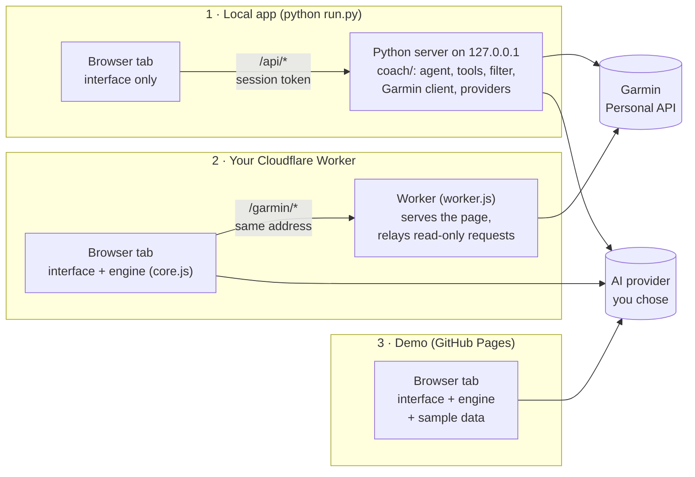
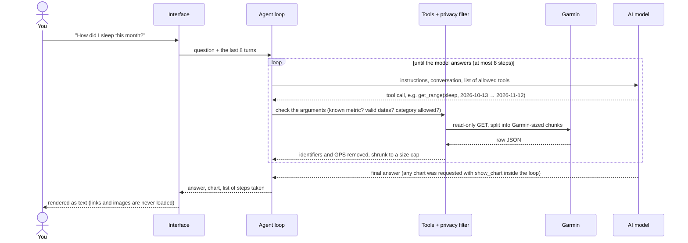
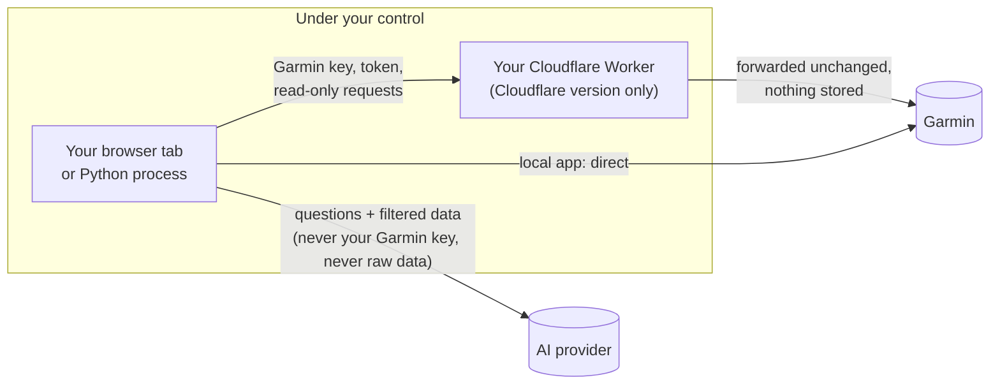

# Garmin AI Coach

Ask questions about your own Garmin data in plain language. The app reads your
data through the
[Garmin Connect Personal API](https://developer.garmin.com/gc-developer-program/personal/),
filters it, and sends only what a question needs to an AI model you choose.


It is a personal tool for one person. It is not affiliated with Garmin. There are
three ways to use it: on your computer, on your own free Cloudflare Worker, or as
a sample-data demo in the browser. [Architecture](#architecture) explains how the
pieces fit together, and [Security trade-offs accepted](#security-trade-offs-accepted)
lists what this design gives up for convenience, and why.

## Run it on your computer (your real data)

You need Python 3.9 or newer. There is nothing else to install.

```
git clone https://github.com/aihtn2708/garmin-ai-coach
cd garmin-ai-coach
python run.py
```

A browser tab opens at `http://127.0.0.1:8765`. Keys stay in the Python program's
memory and never reach the page. Press Ctrl+C in the terminal, or click Quit, to
stop.

## Run it on Cloudflare (your real data, from any device)

A free Cloudflare Worker serves the page and relays Garmin requests from the same
address, which is what gets past Garmin's refusal to answer web pages. The Worker
runs in **your own** Cloudflare account.

1. Create a free account at <https://dash.cloudflare.com> (no card needed).
2. Go to **Workers & Pages**, choose **Create**, then import this GitHub repository.
   Keep the defaults (deploy command `npx wrangler deploy`) and deploy.
3. Open the address Cloudflare gives you, `https://garmin-ai-coach.<your-name>.workers.dev`.
4. Recommended: in the Worker's settings, under **Domains & Routes**, turn on
   **Cloudflare Access** for that address and allow only your own email. Otherwise
   anyone who learns the address can use your relay with their own Garmin key.

Or from a terminal: `npx wrangler login`, then `npx wrangler deploy`.

What to know before you choose this over the local app:

- Your Garmin key and your Garmin data pass through the Worker on their way to and
  from Garmin. The Worker stores nothing and logs nothing
  ([`cloudflare/worker.js`](cloudflare/worker.js) is about 100 lines; read it), but
  they do transit Cloudflare's network in your account.
- Keys are held in the browser tab's memory, not in a program on your computer.
  If you tick "Remember keys on this device" they are also kept, encrypted, in
  that browser.
- The free plan allows 100,000 Worker requests a day. A question uses a handful.
  Scripts, styles and images do not count.
- Confirmed working with a real Garmin key on 12 November 2026. If Garmin ever
  starts turning away requests from Cloudflare, the local app is the fallback.

## Try the demo in your browser (sample data)

**<https://aihtn2708.github.io/garmin-ai-coach/>**

The GitHub Pages copy is the same interface running on built-in sample data. It has
no relay, so it cannot load your own Garmin data: Garmin's API does not accept
requests from web pages (it sends no CORS headers; confirmed on 12 November 2026).
The page never asks for a Garmin key and its security policy does not allow it to
contact Garmin at all.

The AI part of the demo is real. Add a model key and the model analyses the sample
data. That key goes straight from the tab to the provider and is forgotten when
you close or reload the tab.

## Using it

1. **Connect Garmin** (local app or your Cloudflare Worker). Create a key at
   <https://connect.garmin.com/app/settings/personalApiToken> (pick the shortest
   expiry you are comfortable with) and paste it in. Or click "Try it with sample
   data" to look around first.
2. **Choose an AI model.** Pick a provider, paste its API key, click "Load models".
3. **Decide what the AI may see**, then ask a question.

The **data log** button in the top bar opens a panel listing every request that
left your computer, with the exact content sent to the AI model. It stays hidden
until you want it.

## Which model to use

Prices and limits as read on 12 November 2026. They change often; the links are the
source of truth.

| Provider | Cost | What happens to your prompts |
|---|---|---|
| **Google Gemini** | Free tier on Flash and Flash-Lite models ([pricing](https://ai.google.dev/gemini-api/docs/pricing)). Request limits are per project and shown in AI Studio. | On the free tier Google may use prompts to improve its products and human reviewers may read them. Enabling billing on the project stops that ([terms](https://ai.google.dev/gemini-api/terms)). |
| **OpenRouter** | Free models: 20 requests a minute; 50 a day, or 1,000 a day after $10 of credit purchases ([limits](https://openrouter.ai/docs/api-reference/limits)). | Depends on the company hosting each model. Several free models are on hosts that may train on prompts. The app asks OpenRouter to refuse those hosts by default ([policy](https://openrouter.ai/docs/guides/privacy/provider-logging)). |
| **Anthropic Claude** | Paid. Claude Haiku 5.5: $0.10 per million input tokens, $0.50 per million output ([pricing](https://platform.claude.com/docs/en/about-claude/pricing)). | Paid API under Anthropic's commercial terms. |
| **DeepSeek** | Paid. `deepseek-flash`: $0.15 input / $0.60 output per million tokens off-peak, double at peak ([pricing](https://api-docs.deepseek.com/quick_start/pricing)). | Processed in China under DeepSeek's privacy policy. Read it before sending health data. |
| **Local model (Ollama)** | Free; uses your own hardware. Needs a model that supports tools. | Nothing leaves your computer. |

A typical question uses roughly 5,000 to 15,000 input tokens and a few hundred
output tokens (the app shows the real numbers under each answer). On Claude Haiku
5.5 or `deepseek-flash` that works out to well under one US cent per question.

If "no data used for training" matters more to you than "free", the options are a
local model, a paid API, or Gemini with billing enabled.

On Cloudflare and in the demo, the page calls the AI provider directly, so the
provider must accept requests from web pages. Gemini, OpenRouter and Anthropic do.
Reports about DeepSeek conflict. Ollama works if you start it with
`OLLAMA_ORIGINS` set to the page's address. The local app has no such limits.

## Architecture

### The idea in one paragraph

You ask a question in plain language. An AI model decides what data it needs and
asks for it by calling one of six fixed tools. The app (not the model) fetches that
data from Garmin, strips anything identifying, shrinks it, and hands it back. The
model repeats this until it can answer, then writes the answer and, if useful, a
chart. The model never sees a URL, a key or raw Garmin output, and it cannot reach
anything except through those six tools.

### Three ways to run, one codebase



The interface (`docs/index.html`, `app.js`, `style.css`) is the same in all three.
What differs is where the work happens:

| | Local app | Cloudflare Worker | Demo |
|---|---|---|---|
| Who runs the agent, tools and filter | Python server (`coach/`) | The page (`docs/core.js`) | The page (`docs/core.js`) |
| How Garmin is reached | Python calls Garmin directly | Page → Worker relay on the same address → Garmin | Not at all; built-in sample data |
| How the AI model is reached | Python calls the provider | Page calls the provider directly | Page calls the provider directly |
| Where keys are held | Python process memory (or OS keychain if you opt in) | Tab memory (or encrypted browser storage if you opt in) | Tab memory, AI key only |

**How the page knows which version it is.** The local server adds
`data-mode="local"` to the HTML it serves, and the Worker adds `data-mode="relay"`.
With neither (a plain static host), the page is the demo. In local mode `app.js`
sends each action to the Python server as an HTTP request. In the other two it
calls `core.js` instead, which answers the same `/api/...` routes inside the page.
That is why one interface works everywhere.

**Why a relay exists at all.** Garmin's Personal API does not send the headers
browsers require before a page may read a reply from another site (CORS). A page
on GitHub Pages therefore cannot read Garmin's answers. The local app avoids the
browser rule by calling Garmin from Python. The Worker avoids it by putting a relay
on the page's own address, so the browser sees a same-site request.

### What happens when you ask a question



Step by step:

1. **Question in.** The interface sends your question with the last 8 turns of the
   conversation (older answers trimmed), so follow-up questions make sense.
2. **The model plans.** It receives instructions (today's date, how to work, what it
   must not do), the conversation, and descriptions of the tools it may call. Tools
   for data categories you switched off are not even described to it.
3. **The model asks for data.** It can call six tools:

   | Tool | What it returns |
   |---|---|
   | `get_range` | One metric (sleep, HRV, stress, steps, Body Battery, daily summary…) over a date range, optionally averaged by week or month |
   | `get_day` | Detail for one metric on one day (heart rate through the day, sleep stages, HRV readings…) |
   | `list_activities` | Recent workouts, each with a short reference such as A3 |
   | `get_activity` | Full summary and splits for one workout, by its reference |
   | `get_profile` | Age, sex, weight, height, units and heart rate zones |
   | `show_chart` | Draws a line or bar chart next to the answer (no data fetched) |

4. **The app checks and fetches.** Arguments are validated: the metric must be on
   the list, dates must be real and not in the future, ranges are capped (92 days,
   365 for daily summaries), and the category must be switched on. The app maps the
   tool to a fixed Garmin path, splits long ranges into the chunk sizes Garmin
   accepts, and fetches. At most 24 Garmin requests per question.
5. **The filter cleans the result** (`coach/privacy.py`, ported to `core.js`):
   - removes account, user and device identifiers, names, emails, profile images,
     URLs, GPS coordinates and routes, and time zone;
   - turns birth date into age, and real activity IDs into session-only references
     (A1, A2…);
   - in Strict mode, also removes activity names, places and notes;
   - turns long series (a day of heart-rate samples) into min, max, mean and a
     sample; turns lists of records into compact tables; caps each result's size.
6. **Repeat or answer.** The filtered result goes back to the model, which either
   asks for more or writes the answer. After 8 rounds it is told to answer with
   what it has.
7. **Answer out.** The interface renders the answer as text. Model output is never
   inserted as HTML, links are not clickable and images are never loaded, so a
   reply cannot smuggle data out through a URL. Charts are drawn locally as SVG
   from the numbers the model passed to `show_chart`.

Along the way, every request that leaves your computer is recorded in the data
log, with the exact body sent to the AI model.

### Talking to Garmin

- **Key to token.** Your Personal API key is exchanged once for a 24-hour access
  token (`POST …/personal-api-key/token`). Data requests use the token. A new token
  is fetched when less than an hour is left, or once if Garmin rejects one early.
- **Read-only by construction.** Only GET requests to a fixed list of paths are
  possible, in the Python client, in `core.js`, and again in the Worker.
- **Polite.** Responses are cached in memory for 15 minutes, and requests are spaced
  at least 250 ms apart, since Garmin publishes no rate limits.

### Talking to AI providers

Gemini, OpenRouter, DeepSeek and Ollama all accept the OpenAI chat format;
Anthropic has its own. `providers.py` (and its port in `core.js`) has one adapter
for each format and a small table of per-provider details: address, key header,
terms summary. Model lists are fetched live from each provider, so no model name
in the code can go stale. Provider-specific details are handled there: Gemini's
"thought signatures" and DeepSeek's reasoning text are sent back unchanged during
a tool exchange, OpenRouter requests carry "refuse hosts that train on prompts",
and Anthropic requests from a page carry its browser opt-in header.

### Trust boundaries



- **Garmin** sees your key and your requests, as with any Garmin app.
- **The AI provider** sees your questions and the filtered data needed to answer
  them, under that provider's terms. That is the one place your data leaves your
  control, which is why the provider list shows each one's data-use terms and why
  you choose which categories it may see.
- **Cloudflare** (Worker version only) carries your Garmin key and data in transit.
  The Worker forwards only to Garmin, only for its own page, and stores and logs
  nothing.
- **Nobody else.** No database, no analytics, no third-party scripts, styles or
  fonts. The page's Content-Security-Policy makes the browser refuse connections to
  anything not on the list.

[SECURITY.md](SECURITY.md) covers each control and its limits in detail.

### Saved keys (optional)

Off by default. In the Cloudflare and demo versions, "Remember keys on this device"
encrypts your keys, chosen model and settings with AES-256-GCM (the browser's Web
Crypto) and keeps them in that browser. With a passphrase, the encryption key is
derived from it and never stored; without one, it is a non-exportable key kept in
the same browser. The local app uses the operating system's keychain instead.

### Where the code is

| File | Job |
|---|---|
| `docs/index.html`, `app.js`, `style.css`, `fonts/` | The interface, shared by all versions. No libraries; the one typeface (Barlow Condensed, SIL Open Font License) is served from the same folder |
| `docs/core.js` | The engine for the Cloudflare and demo versions: Garmin client (via relay), sample data, privacy filter, tools, providers, agent loop, request log, encrypted key vault |
| `cloudflare/worker.js`, `wrangler.jsonc` | Cloudflare Worker: serves the page, relays read-only Garmin requests |
| `run.py` | Starts the local app |
| `coach/server.py` | Local web server: serves the interface, answers `/api/...`, guards (loopback only, session token, Host and Origin checks, CSP) |
| `coach/net.py` | The only Python code that opens network connections: host allowlist, HTTPS only, no redirects, request log |
| `coach/garmin.py` | Read-only Garmin client, token handling, cache |
| `coach/privacy.py` | What is removed or shrunk before a model sees anything |
| `coach/tools.py` | The six tools and their input checks |
| `coach/providers.py` | Adapters for the OpenAI chat format (Gemini, OpenRouter, DeepSeek, Ollama) and Anthropic's |
| `coach/agent.py` | The question-answering loop and the instructions given to the model |
| `coach/ledger.py`, `keystore.py`, `demo.py` | Request log, optional OS keychain, sample data |
| `tests/` | Python and Node tests, plus stand-in servers for Garmin and the AI providers |

`docs/core.js` is a port of the Python modules. A test feeds both privacy filters
the same inputs and requires identical output, so the two cannot quietly drift apart.

## Security trade-offs accepted

The first version ran only on your own computer and kept every key inside a Python
program. Each step since (a hosted page, a Cloudflare relay, remembered keys) made the
app easier to use, and each one widened what you have to trust. This section lists
those trade-offs in one place, so they are decisions rather than surprises. For the
detailed controls, see [SECURITY.md](SECURITY.md).

| | Trade-off | Applies to | To avoid it |
|---|---|---|---|
| 1 | Your filtered health data goes to an AI company | All versions, unless you use Ollama | Ollama, a paid API, or Gemini with billing on |
| 2 | Keys are held in the web page, not a separate program | Cloudflare, demo | Local app |
| 3 | Your Garmin key and data pass through Cloudflare | Cloudflare | Local app |
| 4 | Others can use your relay address with their own key | Cloudflare | Turn on Cloudflare Access |
| 5 | Whoever controls the repo controls the code that handles your keys | Cloudflare, demo | Local app from a commit you have read |
| 6 | Remembered keys sit in the browser, encrypted | Cloudflare, demo, if you tick the box | Leave it off, or set a passphrase |
| 7 | The privacy filter works by field name and could miss something | All versions | Check the data log once with real data |
| 8 | Answers come from an AI model and can be wrong | All versions | Treat them as a second opinion, not advice |

### 1. Your filtered health data goes to an AI company

- **Why accepted:** the analysis needs a capable model, and the free tiers you asked
  for are run by AI companies.
- **What is exposed:** your questions and the filtered data needed to answer them,
  held under that provider's terms. On Gemini's free tier, Google may use prompts to
  improve its products and people may review them. Some free OpenRouter models are
  hosted by companies that may train on prompts. DeepSeek processes requests in China.
- **What limits it:** identifiers, names, GPS and device details are removed before
  sending; long series are summarised; you choose which data categories the model
  may see (weight, nutrition and menstrual cycle are off by default); Strict mode
  also drops activity names and places; OpenRouter is asked to refuse hosts that
  train; each provider's terms are summarised before you pick it; the data log shows
  exactly what was sent.
- **To avoid it:** use a local model through Ollama (nothing leaves your computer),
  a paid API, or Gemini with billing enabled.

### 2. Keys are held in the web page

- **Why accepted:** to use the app from a browser on any device without installing
  anything (first the GitHub Pages page, then Cloudflare).
- **What is exposed:** anything that can run code inside the page while it is open
  can read your keys. In practice that means a malicious browser extension, or a
  changed copy of the app (see 5). Calling Claude from a page needs Anthropic's
  `anthropic-dangerous-direct-browser-access` header for exactly this reason.
- **What limits it:** the page loads no third-party code, fonts or styles; its
  Content-Security-Policy lets it run only its own scripts and connect only to the
  listed providers; model answers are shown as plain text, so a reply cannot run
  code or load a link.
- **To avoid it:** the local app keeps keys in a Python program; the page never
  sees them.

### 3. Your Garmin key and data pass through Cloudflare

- **Why accepted:** Garmin refuses requests from web pages, so a hosted page needs a
  relay to reach it. You chose a relay in your own Cloudflare account over the local
  app, for access from any device. (An earlier decision that day had been to keep
  real data local-only; this reversed it.)
- **What is exposed:** the connection is decrypted inside Cloudflare's network so the
  Worker can forward it. You are trusting Cloudflare, and the code in `worker.js`.
- **What limits it:** the Worker runs in your account; it forwards only to Garmin,
  only read-only requests on a fixed list, only two headers; it has no storage and
  logging is turned off; replies are marked not to be cached.
- **To avoid it:** the local app talks to Garmin directly from your computer.

### 4. Others can use your relay address

- **Why accepted:** a `workers.dev` address is public by default, and closing it
  needs a separate setting.
- **What is exposed:** someone with a script (not a browser) who learns the address
  could send their own Garmin key through your relay. They get nothing of yours, but
  they use your free-plan quota (100,000 requests a day). Other websites cannot use
  it from a visitor's browser: the relay checks that requests come from its own page.
- **To avoid it:** turn on Cloudflare Access for the address and allow only your own
  email (step 4 under [Run it on Cloudflare](#run-it-on-cloudflare-your-real-data-from-any-device)).

### 5. Whoever controls the repo controls the code that handles your keys

- **Why accepted:** automatic deployment. A push to `main` rebuilds the Cloudflare
  Worker with no further step. The demo is republished from the same files.
- **What is exposed:** if your GitHub account were taken over, a changed page could
  send your keys elsewhere the next time you open it, and the page's own security
  policy would change with it.
- **What limits it:** every change is a visible commit, and each Cloudflare build
  shows on GitHub as a check on the commit it came from. Keep the list of people who
  can push to the repo as short as possible.
- **To avoid it:** turn on two-factor authentication for GitHub and Cloudflare. For
  the strongest guarantee, run the local app from a commit you have read.

### 6. Remembered keys sit in the browser

- **Why accepted:** you asked not to paste keys on every visit. It is off unless you
  tick "Remember keys on this device".
- **What is exposed:** without a passphrase, anyone who can open the page in that
  browser profile can use the saved keys. With a passphrase, someone holding a copy
  of the browser's files could try to guess it; a short one can be guessed.
- **What limits it:** keys are encrypted (AES-256-GCM); without a passphrase the
  encryption key cannot be exported from the browser; with one, it is derived with
  600,000 rounds of PBKDF2, which slows guessing; tampered data fails to open; your
  Garmin data and conversations are never saved; untick the box or click "Forget
  everything" to erase.
- **To avoid it:** leave the box unticked, or set a long passphrase on any device
  someone else uses.

### 7. The privacy filter could miss something

- **Why accepted:** Garmin's full schema was not available while building, and it
  can change, so the filter removes fields by what their names look like rather than
  by a fixed list.
- **What is exposed:** an identifier stored under an unexpected field name could
  reach the AI provider.
- **What limits it:** broad name patterns for identifiers and locations; Strict mode;
  "See exactly what was sent" in the data log.
- **To avoid it:** read one request in the data log with your real data. If anything
  identifying appears, open an issue (without pasting the data) and the filter can
  be tightened.

### 8. Answers come from an AI model

- **Why accepted:** it is the point of the app.
- **What is exposed:** a model can misread numbers or overstate a trend. Text inside
  your own data (an activity name, say) could try to steer it.
- **What limits it:** the model is told to fetch data before any claim, give dates and
  units, and not diagnose. It can only read: its six tools cannot send messages, open
  links or change anything in your Garmin account.
- **To avoid it:** check surprising answers against Garmin Connect. This is not
  medical advice.

### Lines not crossed

These options came up and were deliberately not taken:

- No relay, server or storage run by anyone but you.
- No analytics, tracking or third-party code, fonts or styles.
- No write access to Garmin: only the read-only paths can be called.
- The public demo never asks for, stores or sends a Garmin key.

### Still to do on your side

- Turn on Cloudflare Access for your Worker's address.
- Turn on two-factor authentication for GitHub and Cloudflare.
- Give your Garmin key a short expiry (30 or 90 days) and renew it.
- Use a separate AI key for this app, with a spending limit where the provider has one.

## What has and has not been tested

```
python -m unittest discover -s tests -t . -v     # local app, 19 tests
node --test tests/test_core.js                   # page engine, key vault and Cloudflare relay, 15 tests
```

Tested:

- the privacy filter, tool input checks, range chunking and size limits, in both
  versions, plus a check that the JavaScript filter matches the Python one;
- the Garmin client against a local stand-in for Garmin's API (token exchange,
  token refresh, caching, path allowlist);
- both model wire formats against local stand-in servers, including Gemini's
  thought-signature round trip;
- the local server's guards and a full question-to-answer session;
- the Cloudflare Worker in Cloudflare's own runtime on a test machine: the page,
  its security headers, and the relay refusing every request that is off its
  list or not from its own page;
- remembering keys: nothing is stored without opting in, stored keys are never
  readable as plain text, a wrong passphrase or altered data fails to open, and
  "Forget everything" erases them;
- all three versions in Chrome, including that the pages store nothing by
  default, that the demo never sends a Garmin key, and that the browser blocks
  connections to unlisted hosts.

Used for real: the Cloudflare version, with a real Garmin key and a real AI
provider, since 12 November 2026.

Not yet tried with real keys: the local app, and most of the five providers. Expect
rough edges there. Likely places:

- **Garmin response shapes.** Garmin's Swagger page could not be read while
  building, so the filter does not assume field names; it works on any JSON. If
  an answer looks thin, open "See exactly what was sent" in the log to see what
  the model received.
- **Provider quirks.** Free OpenRouter models vary in how well they use tools. If
  one misbehaves, try another.

## Limits to know about

- The Personal API is pull-only and read-only. Some Garmin-computed metrics
  (VO2 max, recovery time and similar) are reported to be missing from it.
- Garmin publishes no rate limits and may throttle. The app caches responses for
  15 minutes and caps each question at 24 Garmin requests.
- Ranges are capped at 92 days per request (365 for daily summaries). For longer
  spans the model is told to ask for weekly or monthly averages.
- Activity FIT files (second-by-second data) are not downloaded or parsed.
- Garmin's terms say the key is for you alone, with tools you run for your own
  use. Never share your key. Deploy the Worker only in your own Cloudflare
  account, keep it to yourself, and never use someone else's deployment.
- This is not medical advice.

## Remembering your keys

By default you paste keys each time, and they are forgotten when you leave.

**On Cloudflare and in the demo:** tick **Remember keys on this device** at the
bottom of the setup panel. Your keys, chosen model and settings are encrypted and
kept in that browser, and Garmin reconnects by itself next time. Add a passphrase
if anyone else uses the same browser; you will be asked for it on each visit.
Untick the box, or click "Forget everything", to erase them.

**Local app:** install the optional keychain helper, restart, and tick the box.
Keys go into your operating system's keychain.

```
pip install keyring
```

## Updating the hosted demo

Cloudflare redeploys by itself when you push to `main`, if you imported the
repository there. GitHub Pages serves the `gh-pages` branch, which is a copy of the `docs/` folder on
`main`. After changing anything in `docs/`, commit to `main`, then republish:

```
git push origin main
git push origin `git subtree split --prefix docs main`:gh-pages --force
```

To drop the second branch, set Settings → Pages to branch `main`, folder `/docs`,
and delete `gh-pages`.

## Ideas for later

- Parse FIT files locally for pace, power and heart-rate-zone analysis
- A weekly summary generated on a schedule
- Token-by-token streaming of answers
- A cost estimate per answer from live provider prices

## Licence

MIT. See [LICENSE](LICENSE).
