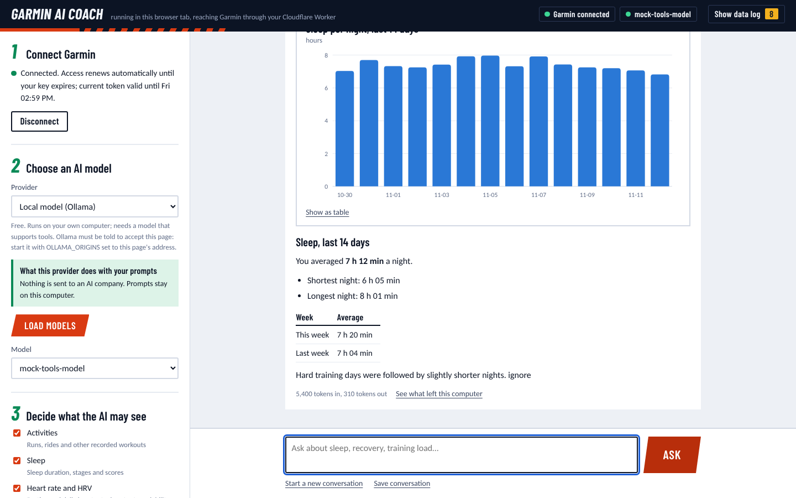

# Garmin AI Coach

Ask questions about your own Garmin data in plain language. It runs in your browser
or on your computer, reads your data through the
[Garmin Connect Personal API](https://developer.garmin.com/gc-developer-program/personal/),
filters it, and sends only what a question needs to an AI model you choose.



It is a personal tool for one person. It is not affiliated with Garmin.

## Two ways to run it

### 1. In your browser, nothing to install

Open **<https://aihtn2708.github.io/garmin-ai-coach/>**.

The page is a set of static files. There is no server behind it: your browser talks
directly to Garmin and to the AI provider you choose. Keys live in the tab's memory
and are gone when you close or reload it.

One thing is not yet confirmed: whether Garmin's API accepts requests made by a web
page (a browser rule called CORS). If it does not, "Connect Garmin" will say so, and
the local app below is the way to go. "Try it with sample data" works either way.

### 2. On your computer

You need Python 3.9 or newer. There is nothing else to install.

```
git clone https://github.com/aihtn2708/garmin-ai-coach
cd garmin-ai-coach
python run.py
```

A browser tab opens at `http://127.0.0.1:8765`. Keys stay in the Python program's
memory rather than in the page, and Garmin's browser rules do not apply. Press
Ctrl+C in the terminal, or click Quit, to stop.

### Then, in either one

1. **Connect Garmin.** Create a key at
   <https://connect.garmin.com/app/settings/personalApiToken> (pick the shortest
   expiry you are comfortable with) and paste it in. Or click "Try it with sample
   data" to look around first.
2. **Choose an AI model.** Pick a provider, paste its API key, click "Load models".
3. **Decide what the AI may see**, then ask a question.

## Which model to use

Prices and limits as read on 12 November 2026. They change often; the links are the
source of truth.

| Provider | Cost | What happens to your prompts |
|---|---|---|
| **Google Gemini** | Free tier on Flash and Flash-Lite models ([pricing](https://ai.google.dev/gemini-api/docs/pricing)). Request limits are per project and shown in AI Studio. | On the free tier Google may use prompts to improve its products and human reviewers may read them. Enabling billing on the project stops that ([terms](https://ai.google.dev/gemini-api/terms)). |
| **OpenRouter** | Free models: 20 requests a minute; 50 a day, or 1,000 a day after $10 of credit purchases ([limits](https://openrouter.ai/docs/api-reference/limits)). | Depends on the company hosting each model. Several free models are on hosts that may train on prompts. The app asks OpenRouter to refuse those hosts by default ([policy](https://openrouter.ai/docs/guides/privacy/provider-logging)). |
| **Anthropic Claude** | Paid. Claude Haiku 5.5: $0.10 per million input tokens, $0.50 per million output ([pricing](https://platform.claude.com/docs/en/about-claude/pricing)). | Paid API under Anthropic's commercial terms. |
| **DeepSeek** | Paid. `deepseek-flash`: $0.15 input / $0.60 output per million tokens off-peak, double at peak ([pricing](https://api-docs.deepseek.com/quick_start/pricing)). | Processed in China under DeepSeek's privacy policy. Read it before sending health data. |
| **Local model (Ollama)** | Free; uses your own hardware. Needs a model that supports tools. | Nothing leaves your computer. |

A typical question uses roughly 5,000 to 15,000 input tokens and a few hundred
output tokens (the app shows the real numbers under each answer). On Claude Haiku
5.5 or `deepseek-flash` that works out to well under one US cent per question.

If "no data used for training" matters more to you than "free", the options are a
local model, a paid API, or Gemini with billing enabled.

In the browser version, a provider must also accept requests from web pages. Gemini,
OpenRouter and Anthropic do. Reports about DeepSeek conflict. Ollama works if you
start it with `OLLAMA_ORIGINS=https://aihtn2708.github.io`.

## How it works

```
 Browser tab
   │
   ├── Garmin client ──────────► personal.connectapi.garmin.com   read-only GETs
   │        │
   │        ▼
   │   privacy filter: remove IDs, names, GPS, device details;
   │   alias activity IDs; summarise long series; cap size
   │        │
   ├── agent loop ◄────────────  the model may only call 6 fixed tools
   │        │
   └── provider adapter ───────► the one AI provider you picked
            │
            ▼
     log: every outbound request, shown in the page
```

In the browser version all of this runs inside the page (`docs/core.js`). In the
local version the same steps run in a small Python server on `127.0.0.1`
(`coach/`), and the page only draws the interface.

The model never receives a URL, a key or raw Garmin output. It can ask for one of
six things (a metric over a date range, one day's detail, the activity list, one
activity, your profile and zones, or a chart). The app validates the request,
fetches from Garmin, filters the result and passes it on.

| File | Job |
|---|---|
| `docs/index.html`, `app.js`, `style.css` | The interface, shared by both versions. No libraries |
| `docs/core.js` | Browser version: Garmin client, privacy filter, tools, providers, agent, log |
| `run.py` | Starts the local version |
| `coach/server.py` | Local web server and its protections |
| `coach/net.py` | The only Python code that opens network connections; host allowlist |
| `coach/garmin.py` | Read-only Garmin client, token handling |
| `coach/privacy.py` | What is removed or shrunk before a model sees anything |
| `coach/tools.py` | The six tools and their input checks |
| `coach/providers.py` | Gemini, OpenRouter, DeepSeek, Ollama (OpenAI format) and Anthropic |
| `coach/agent.py` | The question-answering loop and the system prompt |
| `coach/ledger.py`, `keystore.py`, `demo.py` | Outbound log, optional OS keychain, sample data |

`docs/core.js` is a port of the Python modules, and a test checks that both privacy
filters give the same output on the same input.

Security and governance details are in [SECURITY.md](SECURITY.md).

## What has and has not been tested

```
python -m unittest discover -s tests -t . -v     # local version, 19 tests
node --test tests/test_core.js                   # browser version, 9 tests
```

Tested:

- the privacy filter, tool input checks, range chunking and size limits, in both
  versions, plus a check that the JavaScript filter matches the Python one;
- the Garmin client against a local stand-in for Garmin's API (token exchange,
  token refresh, caching, path allowlist);
- both model wire formats against local stand-in servers, including Gemini's
  thought-signature round trip;
- the local server's guards and a full question-to-answer session;
- both versions in Chrome at desktop and phone widths, including that the page
  stores nothing and that the browser blocks connections to unlisted hosts.

Not tested: a real Garmin key or a real provider key. None were available while
building this, so expect rough edges on first contact. Likely places:

- **Garmin from a web page.** Whether Garmin allows browser requests is unknown.
- **Garmin response shapes.** Garmin's Swagger page could not be read while
  building, so the filter does not assume field names; it works on any JSON. If
  an answer looks thin, open "See exactly what was sent" in the log to see what
  the model received.
- **Provider quirks.** Free OpenRouter models vary in how well they use tools. If
  one misbehaves, try another.

## Limits to know about

- The Personal API is pull-only and read-only. Some Garmin-computed metrics
  (VO2 max, recovery time and similar) are reported to be missing from it.
- Garmin publishes no rate limits and may throttle. The app caches responses for
  15 minutes and caps each question at 24 Garmin requests.
- Ranges are capped at 92 days per request (365 for daily summaries). For longer
  spans the model is told to ask for weekly or monthly averages.
- Activity FIT files (second-by-second data) are not downloaded or parsed.
- Garmin's terms say the key is for you alone, with tools you run for your own
  use. Never share your key. The hosted page is public, but it has no server and
  no accounts: each visitor's browser uses only that visitor's own key. If you
  fork this, keep it that way.
- This is not medical advice.

## Optional: remember keys between sessions (local version only)

By default you paste keys each time you start the app. To store them in your
operating system's keychain instead:

```
pip install keyring
```

Restart the app and tick "Remember keys in this computer's keychain". The browser
version never stores keys.

## Updating the hosted page

GitHub Pages serves the `gh-pages` branch, which is a copy of the `docs/` folder on
`main`. After changing anything in `docs/`, commit to `main`, then republish:

```
git push origin main
git push origin `git subtree split --prefix docs main`:gh-pages --force
```

To drop the second branch, set Settings → Pages to branch `main`, folder `/docs`,
and delete `gh-pages`.

## Ideas for later

- Parse FIT files locally for pace, power and heart-rate-zone analysis
- A weekly summary generated on a schedule
- Token-by-token streaming of answers
- A cost estimate per answer from live provider prices

## Licence

MIT. See [LICENSE](LICENSE).
